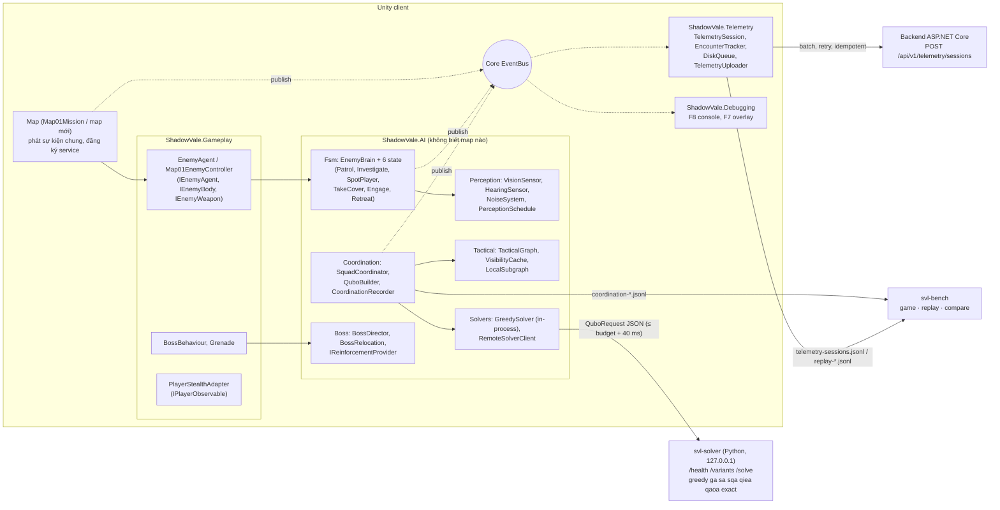
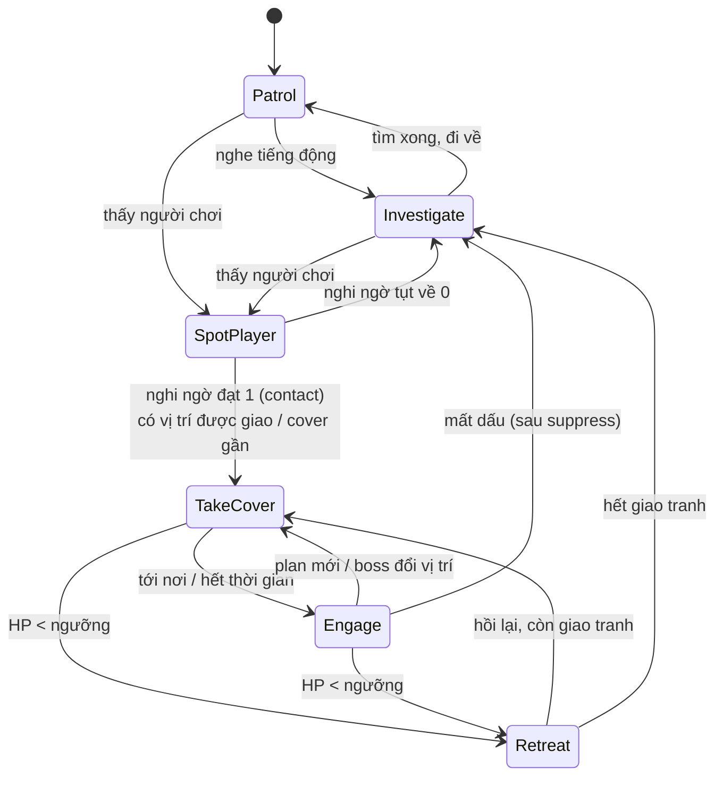
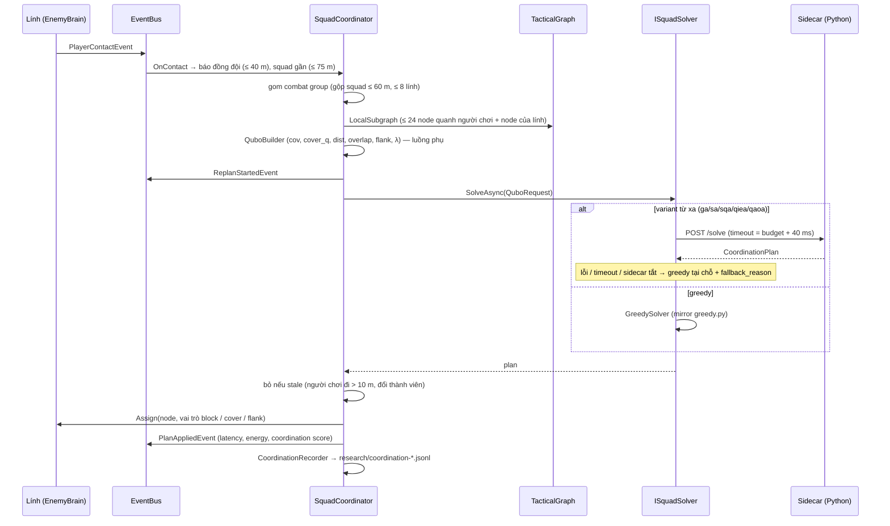

# Kiến trúc AI và điều phối squad (Optimization / AI Design)

Tài liệu này mô tả phần AI của địch (A01–A04, G04), engine điều phối QUBO (A02–A03, O1–O5) và telemetry
(G10, T01–T02). Phần chạy trong game và phần chạy ở sidecar Python được tách riêng.

## 1. Thành phần

Các quy tắc phụ thuộc giữa assembly:
- `AI → Core, Data, Content, Networking`. AI không thấy Gameplay hay map, chỉ làm việc qua interface
  (`IEnemyBody`, `IEnemyWeapon`, `IEnemyTactics`, `IPlayerObservable`, `IWorldQuery`).
- `Gameplay → AI`, `Telemetry → AI`, `Map01 → AI, Gameplay, Telemetry`.
- AI không gọi telemetry hay debug console. Nó chỉ publish sự kiện lên `EventBus`; cả hai đều nghe cùng
  một luồng sự kiện đó.

**Map khác nhau ở đâu.** Mọi map dùng chung AI; phần khác nhau nằm ở:
- **dữ liệu**: `EnemyArchetype` (kể cả `boss`), `ai_settings.squad`, `maps[].coordination`;
- **hook**: `IEnemyTactics` (mục tiêu thay thế, cover, điểm rút lui), `ICoordinationTask` (escape node,
  trọng số), `IReinforcementProvider`;
- **component bổ sung**: `BossBehaviour`.

Map 2 đã chạy được một squad gồm các `EnemyAgent` chung mà không dùng dòng code nào của Map 1
(`Map2ReuseTests`).

## 2. FSM sáu trạng thái (A01)

- Mọi điều kiện chuyển state nằm gọn trong `EnemyTransitions.Next`. Mỗi state chỉ thực hiện hành động
  của mình (một file cho mỗi state).
- Engage có hai chế độ: bắn có ngắm khi thấy người chơi, và bắn chặn (suppress) vào vị trí cuối cùng
  thấy người chơi trong vài giây sau khi mất tầm nhìn.
- Chết là vòng đời của agent, không phải state.
- Boss không có state thứ bảy: "đổi vị trí" chỉ là một vị trí mới giao cho TakeCover.

## 3. Một lần re-plan của squad (A02–A03)

Các trigger re-plan:
- `first_contact`: lần đầu phát hiện;
- `members_changed`: thành viên nhóm thay đổi;
- `player_moved`: người chơi đi ≥ 2 hop trên graph;
- `refresh`: định kỳ mỗi 6 s;
- `requested`: ép re-plan từ console.

Giữa hai lần re-plan có cooldown 0.8 s.

## 4. Công thức QUBO (O1)

Biến x[a,n] = 1 nghĩa là lính a đứng tại node n. Năng lượng cần cực tiểu:
E = −F + λ·(ràng buộc one-hot theo lính + không trùng node), với

F = w_cov·cov + w_cover·cover_q − w_dist·dist − w_red·overlap + w_flank·flank

- `cov`: các escape node được nhìn thấy từ vị trí của lính.
- `cover_q` = is_cover · max(0, cos(hướng cover, hướng node → người chơi)).
- `overlap`: hai lính cùng nhìn một escape node (hạng tử cặp).
- `flank`: góc giữa hai lính quanh người chơi (hạng tử cặp).

λ = 1 + L + 2(A−1)P⁺ + D + (A−1)P⁻ đủ lớn để mọi nghiệm vi phạm ràng buộc đều có năng lượng cao hơn
nghiệm hợp lệ tốt nhất (chứng minh trong `svl_solver/qubo/penalties.py`). Ma trận Q là tam giác trên,
lưu theo hàng; offset = λ·A.

C# `QuboBuilder` khớp Python tới sai số 1e-9. Điều này được kiểm bằng `QuboParityTests` trên dữ liệu sinh
và `test_game_records.py` trên bản ghi thật từ Map 1.

## 5. Solver (O2–O4)

| id | Họ | Ghi chú |
|---|---|---|
| greedy | classical | Trong Unity; là baseline và là fallback bắt buộc |
| ga | classical | Tiến hoá trên phép gán, nên luôn hợp lệ |
| sa | classical | dwave-neal (simulated annealing cổ điển) |
| sqa | quantum-inspired | Path-integral Monte Carlo tự viết (P bản sao Trotter, trường ngang Γ) |
| qiea | quantum-inspired | Han & Kim: Q-bit, phép quay, repair |
| qaoa | mạch lượng tử (mô phỏng) | Statevector chính xác, tối đa 18 qubit; lớn hơn → fallback kèm lý do |
| brute / exact | tham chiếu | Duyệt hết khi ≤ 5·10⁶ nghiệm; branch-and-bound chứng minh tối ưu cho bài 6×24 |
| qpu | stretch | D-Wave Leap, chưa làm |

Sidecar đóng gói thành `svl-solver.exe` (`scripts/build_sidecar.ps1`). Bước post-build của Unity
(`SidecarBuildStep`) chép file này vào `<game>/Solver/`.

Hợp đồng JSON hai phía được kiểm bằng `SolverContractTests`, chạy trên fixture xuất từ sidecar thật.

## 6. Boss (A04)

- `BossDirector` (logic thuần) quyết định **khi nào**:
  - đổi vị trí khi đứng một chỗ quá 12 s hoặc mất 15% HP tại chỗ;
  - ném lựu đạn khi người chơi núp yên ≥ 4 s, trong tầm ném, đã hết cooldown;
  - gọi viện một lần khi HP < 50%.
- `BossBehaviour` thực hiện **cái gì** trên tactical graph.
- Mọi tham số lấy từ `enemy_archetypes[].boss`. Boss không nằm trong plan của squad.

## 7. Telemetry và chỉ số nghiên cứu (G10, T01–T02, RQ4)

- `TelemetrySession` chỉ nghe `EventBus`. Mỗi session là một lần chơi một map.
- Dữ liệu ẩn danh: GUID tạo riêng cho từng session, không có thông tin máy hay người dùng.
- Batch được ghi ra đĩa trước (`telemetry/pending`), rồi upload nền có retry và Idempotency-Key.
  Hợp đồng ở `Docs/Contracts`.
- Chỉ số: capture rate, escape time, coordination score, plan entropy, `valid_for_comparison`.
- Quy trình thí nghiệm: `Docs/Experiments/protocol.md`.

## 8. Hiệu năng (NFR)

- Lính chưa giao tranh quét tầm nhìn 10 Hz, lệch pha nhau theo id. Lính đang giao tranh, đang nghi
  ngờ hoặc đang thấy người chơi thì quét mỗi frame (`PerceptionSchedule`).
- `VisionSensor` loại theo khoảng cách và góc trước khi raycast.
- Visibility cache của graph tính trải qua nhiều frame, 600 cặp mỗi frame.
- Dựng QUBO và gọi solver đều chạy ngoài main thread. Solver từ xa bị cắt ở budget + 40 ms, nên một lần
  re-plan không bao giờ trễ hay thiếu plan.
