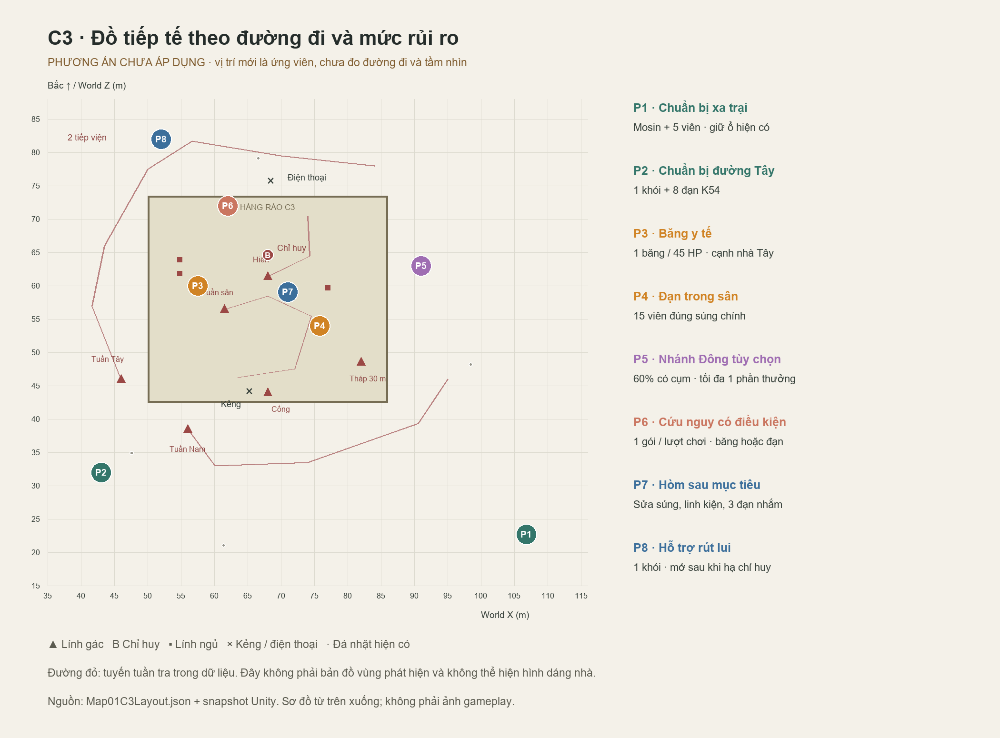

# Phương án vật phẩm và độ khó nhiệm vụ 3 — C3

**Cập nhật sau phản hồi chơi thực tế:** đã sửa nhịp bắn NPC và triển khai tiếp tế sớm theo [báo cáo tiếp tế/giao chiến](../Supply_Combat_Flow_20261022/KET_QUA.md). Bản 8 điểm dưới đây giữ làm phương án tham khảo; đợt triển khai mới dùng 2 điểm C3, phần thưởng C1 và các hòm/kho. Chưa áp dụng giảm túi đạn lính xuống 6 viên hoặc toàn bộ 8 điểm.

Ngày 22/10/2026. Đây là **phương án thiết kế chưa áp dụng vào game**. M16 đã được sửa riêng; bố trí, loot table, địa hình và mục tiêu C3 hiện giữ nguyên. Số liệu nền lấy từ code và snapshot Unity `current-runtime-layout.json`. Ảnh `c3-proposal-layout.png` là sơ đồ đề xuất, không phải ảnh gameplay hay bản đồ đường đi đã kiểm thử.

## Kết luận thiết kế

Giữ C3 là nhiệm vụ xâm nhập: quan sát → chọn đường → xử lý báo động → hạ chỉ huy → rút lui. Tài nguyên quan trọng phải có nguồn lấy được khi đi lén. Lính bị hạ cho ít đạn hơn lượng trung bình tiêu tốn để hạ chúng. Đồ mạnh thêm nằm ở nhánh có rủi ro hoặc sau mục tiêu. Không dùng tăng máu lính để bù cho M16 đang quá mạnh.

## Tài liệu đã đọc và điều áp dụng

| Nguồn gốc | Bài học áp dụng |
|---|---|
| [Michael Booth / Valve, The AI Systems of Left 4 Dead, 2009, slide 74, 77–81, 91](https://steamcdn-a.akamaihd.net/apps/valve/2009/ai_systems_of_l4d_mike_booth.pdf) | Designer đặt các vị trí có chủ đích, hệ thống chọn cụm đồ nào xuất hiện. Nhịp căng thẳng cần có đoạn giảm. Director điều chỉnh nhịp, không tự ý đổi độ khó nền. C3 dùng một nhánh ngẫu nhiên nhỏ, các công cụ cần thiết vẫn có nguồn chắc chắn. |
| [Nhóm thiết kế Sniper Elite 5 / Landing Force trên Xbox Wire, 27/7/2022](https://news.xbox.com/en-us/2022/07/27/185322/) | Nhóm thiết kế mô tả nhiều tuyến tìm và hoàn thành mục tiêu. Phần trao đổi combat phân biệt công cụ bắn lén với vũ khí ứng phó khi bị phát hiện. C3 giữ hai đường tiếp cận, giới hạn đạn nhắm và có khói rút lui. |
| [PUBG, Update 22.2, 8/3/2023](https://pubg.com/en-asia/news/4555?category=patch_notes) | Bản cập nhật cân bằng cả đặc tính súng và độ phổ biến; ví dụ giảm tần suất shotgun/đạn ở Normal khoảng 30%. M16A4 tăng 600 → 800 RPM ở chế độ single/burst, không có full auto. Không sao chép RPM của burst thành tốc độ xả cò và không sao chép damage PvP sang HP của ShadowVale. |

Các con số đề xuất bên dưới là giả thuyết cân bằng riêng cho ShadowVale, không phải tỉ lệ chuẩn từ các game tham khảo và chưa phải kết quả playtest người chơi.

## Hiện trạng đã xác minh

- C3 có 6 vai lính gác, 1 chỉ huy, 3 lính ngủ, 2 lính tiếp viện. Lính ngủ vẫn có GameObject đang hoạt động để diễn hoạt trên giường; không được coi là 3 người đã tham chiến. Nguồn: `Map01C3Mission.cs:150` (đặt vai), `:195` (dựng dự bị), `Map01C3Layout.json`.
- Snapshot: lính gác 100 HP, chỉ huy 700 HP; tháp canh tầm nhìn 30 m, các lính gác khác 14 m, chỉ huy 20 m. Đây là tầm nhìn cơ sở; còn phụ thuộc hướng nhìn, tư thế, vật cản và trạng thái AI. Không phải cứ đứng trong bán kính là bị phát hiện.
- Ổ Mosin tại X/Z **106,8 / 22,7** cấp chắc chắn 1 Mosin + 5 viên, xuất hiện từ nhiệm vụ chỉ huy. Nguồn: `Map01C3Mission.BuildCache`, `lt_m1_mosin_cache`.
- Hòm C3 tại **71 / 59,05**, khóa bởi chỉ huy. Sau khi chỉ huy chết mới mở được, không đòi hạ sạch trại. Nguồn: `Map01CampChests.Guards`, `StateOf`, `Use`.
- Hòm hiện đảm bảo 10 đạn nhắm, 1 kính ngắm, 1 thuốc nổ, 1 sửa súng, 1 băng; thêm 3 lượt ngẫu nhiên. Một lần đo Unity cho 13 đạn nhắm và 2 băng: đó là **một seed minh họa**, không phải kết quả cố định. Hòm đến quá muộn để giải quyết thiếu đồ trước trận, nhưng làm đạn nhắm dư sau mục tiêu.
- Túi lính nhiệm vụ đảm bảo 10–16 viên súng trường và 2 lượt ngẫu nhiên. Tính theo đúng trọng số hiện tại: trung bình **19,64 viên đúng loại súng lính mang** mỗi túi, trước hỗ trợ thiếu đạn. `MatchGuardAmmo` đổi cả ammo sniper ngẫu nhiên sang loại đạn súng trường lính đang dùng; không coi lính là nguồn đạn Mosin chắc chắn.
- Xác suất có ít nhất một băng trong túi lính nhiệm vụ khoảng **16,58%**, chưa tính hỗ trợ khi thiếu máu và cơ chế bù sau 6 túi. Tier odds 60/26/11/3 là xác suất bậc của **mỗi lượt roll**, không phải 60% mỗi lính cho đạn hoặc 3% mỗi lính cho lựu đạn. Nguồn: `Map01LootRoller.Pick`, `Map01Logistics.GuardPack`, `Resources/Loot/Map01Loot.json`.
- Hiện có thời gian phản ứng kẻng 4 s, kiểm quân 90 s, tiếp viện sau gọi 25 s, và giới hạn truy đuổi ngoài hàng rào 40 m. Tháo dùi, cắt điện thoại, bị phát hiện và phát hiện xác là các hệ thống đã có. Không thay đổi hành vi chỉ huy trong đợt cân bằng M16.

## Bố trí đề xuất cho mức Thường

Tọa độ mới là X/Z ứng viên. Khi triển khai phải thử đường đi, mặt đất, tầm tương tác, hướng nhìn lính và vùng diễn hoạt; không đặt thẳng theo tọa độ rồi coi là hoàn tất. P1/P7 là vị trí hiện có đã đo. Hàng rào và đường tuần tra trên sơ đồ lấy từ dữ liệu; sơ đồ không mô tả hình dạng nhà hay tầm nhìn thực.

| Điểm | Vị trí X/Z | Nội dung | Vai trò / điều kiện |
|---|---|---|---|
| P1 | 106,8 / 22,7 | 1 Mosin + 5 viên | Giữ ổ hiện có, có dấu hiệu dẫn tới điểm quan sát. Một lần từ lúc nhận nhiệm vụ. |
| P2 | 43 / 32 | 1 khói + 8 viên K54 | Túi trinh sát đường Tây trước hàng rào; công cụ xâm nhập không phụ thuộc giết lính. |
| P3 | 57,5 / 60 | 1 băng, hồi 45 HP | Mé ngoài cửa nhà Tây, có ký hiệu y tế, tránh các giường và vùng diễn hoạt hạ gục. |
| P4 | 75,8 / 54 | 15 viên đúng loại súng trường mang theo | Hòm đạn trong sân có tuần tra. Lấy được khi đi lén, đổi rủi ro lấy tiếp tế. |
| P5 | 91 / 63 | Một phần thưởng tùy seed | Nhánh Đông không bắt buộc. 60% có cụm; trong cụm chọn **đúng một**: 2 đạn Mosin 45%, 1 khói 35%, 1 sửa súng 20%. |
| P6 | 62 / 72 | Một gói cứu nguy | Hốc có sẵn từ đầu, lùi vào trong hàng rào. Khi mở lần đầu: HP < 40 và không có băng → 1 băng; nếu không, đạn súng trường trong băng + dự trữ < 15 → 15 viên; còn lại 1 vải. Chốt kết quả một lần và lưu. |
| P7 | 71 / 59,05 | 1 sửa súng + 2 linh kiện + 3 đạn nhắm; 2 lượt vật liệu | Hòm sau chỉ huy; giữ +60 hậu cần hoàn thành đang có, không cộng thêm lần nữa. Thay gói 10 đạn nhắm hiện tại. |
| P8 | 52 / 82 | 1 khói | Mở từ lúc chỉ huy chết, hỗ trợ rút lui. Cần kiểm tra không nằm ngay điểm hai lính tiếp viện xuất hiện. |

P4/P6 cấp một loại đạn: ưu tiên M16/AK Nam đang mang; nếu Nam cầm Mosin thì tìm khẩu AR trong hành trang, nếu không có AR thì thay bằng 8 viên K54. Lưu lựa chọn sau lần tạo loot đầu tiên; đổi súng hay tải save không đổi phần thưởng hoặc cấp thêm đồ. P6 ưu tiên băng khi đồng thời thiếu cả máu và đạn.

P5 có xác suất thực trên mỗi lượt chơi: 27% nhận 2 đạn nhắm, 21% nhận khói, 12% nhận sửa súng, 40% không có cụm. Không được hiểu các tỷ lệ 45/35/20 là xác suất toàn bản đồ. Vật phẩm nhiệm vụ, dùi kẻng và điện thoại không ngẫu nhiên.

Hai lượt vật liệu P7, mỗi lượt: 40% kim loại vụn (1–2), 30% vải (1–2), 15% thuốc súng (1–2), 10% dầu súng (1), 5% linh kiện (1). Tổng 100%, không thêm Epic/lựu đạn ngẫu nhiên trước mục tiêu. Đá hiện có giữ nguyên; lượng người chơi mang sẵn cần đo khi playtest, không tự xóa hoặc giới hạn hành trang cũ.

## Giảm lợi ích của việc hạ lính để lấy tài nguyên

Tạo **bảng loot riêng cho lính C3**, gồm cả lính ngủ đã thức và tiếp viện, không sửa bảng lính chung của các nhiệm vụ khác:

Chọn thành viên bằng roster C3 (các vai, `Sleepers`, `RunnerGuards`), không chỉ bằng `operationIndex == 3`: lính ngủ và tiếp viện hiện có index 0. Chỉ huy giữ nhóm thưởng riêng. Lính bị hạ ngay trên giường cũng thuộc phạm vi C3; trạng thái đang ngủ không làm chúng trở lại loot tuần tra chung.

| Phần | Đề xuất |
|---|---|
| Đạn súng lính đang mang | Chắc chắn 4–8 viên, trung bình 6. Không roll thêm đạn súng trường. |
| Một lượt đồ phụ | 50% không thêm; 15% 1 vải; 15% 1 kim loại vụn; 12% 4 viên K54; 5% 1 băng; 3% 1 dầu. Tổng 100%. |
| Súng lính để lại | Giữ loại, độ mòn và save hiện có; không làm đầy băng miễn phí khi nhặt súng. |
| Hỗ trợ thiếu đồ | Chuyển hỗ trợ C3 sang P6 có giới hạn; không nhân đôi đạn hoặc bù băng theo chuỗi giết lính trong C3. Giữ hệ thống ngoài C3. |

Với lính 100 HP và M16 mới, cần 5 viên trúng. Giả định 45% số phát trúng, chi phí trung bình khoảng **11,11 viên/lính**. Túi hiện trả 19,64 viên nên có lãi khoảng 8,53 viên; đề xuất 6 viên làm tiêu hao ròng khoảng 5,11 viên. Đây là phép tính kỳ vọng, không đảm bảo từng trận hoặc tính các phát Mosin/dao. Dao lén vẫn có lợi vì giảm nguy cơ báo động; không cân bằng bằng cách buộc dao cũng tốn đạn.

Ngân sách để bắt đầu playtest: Nam vào vùng C3 khoảng 100 HP, AR 30 viên trong băng + 30 dự trữ, 1 băng, K54 8 viên; P1 cấp thêm 5 Mosin. Đây là **kịch bản đo**, không phải thao tác ép lại đồ người chơi. Nguồn chắc chắn trước mục tiêu: 15 viên AR, 8 K54, 1 khói, 1 băng; P6 tối đa thêm một gói. Nhánh tùy chọn tối đa 2 đạn nhắm. Sau mục tiêu thêm 3 viên nhắm và 1 khói. Đạn Mosin mỗi viên là một mạng nên tính theo số cơ hội hạ địch, không dùng cùng kích cỡ gói AR.

## Độ khó: tăng áp lực qua tình huống và tài nguyên

Đợt đầu giữ số lính và các cơ chế 4 s / 90 s / 25 s / 40 m hiện có để đo tác động riêng của loot và M16. Giữ Mosin một phát hạ địch theo yêu cầu, kể cả chỉ huy khi thực sự trúng và không có bảo vệ cinematic. Bố trí phải cho phép một lần bắn tốt kết thúc mục tiêu; không thêm lá chắn hoặc tăng HP để vô hiệu hóa lựa chọn này.

| Biến | Dễ — cấu hình thử | Thường — ưu tiên triển khai | Khó — cấu hình thử |
|---|---:|---:|---:|
| Gói AR P4 | 20 | 15 | 10 |
| Gói Mosin P1 | 7 | 5 | 4 |
| Gói cố định K54 P2 | 12 | 8 | 6 |
| P5 xuất hiện | 75% | 60% | 40% |
| Đạn/túi lính C3 | 6–10 | 4–8 | 3–6 |
| Trì hoãn kẻng | 6 s | 4 s hiện có | 3 s |
| Tiếp viện sau khi gọi | 30 s | 25 s hiện có | 20 s |
| Máu lính / sát thương mỗi vũ khí | Giữ nguyên | Giữ nguyên | Giữ nguyên |

Các mức Dễ/Khó là đề xuất sau khi mức Thường được thử, chưa giả định game đã có lựa chọn độ khó này. Không tăng tầm nhìn của địch bằng tầm bắn 200 m của Nam. Không để lính tự biết vị trí Nam chỉ vì một xác xuất hiện; giữ điều tra nơi nghe tiếng/nơi phát hiện xác và chỉ chia sẻ thông tin thực sự biết.

## Cách xác nhận trước khi áp dụng rộng

1. Dựng P2–P8 bằng runtime config và ID save riêng; giữ art/scene và hoạt ảnh giường đã duyệt. Không spawn vật phẩm tại vị trí tùy tiện sau lưng người chơi.
2. Đi bộ kiểm tra cả hai tuyến Tây/Đông, núp, tương tác, vật phẩm không xuyên tường/giường, không chắn cửa hoặc lộ nguyên cụm từ một góc duy nhất. Bổ sung tín hiệu hình ảnh bằng đồ vật phù hợp công năng; không dùng cột sáng lớn làm lộ mọi thứ.
3. Đo 3 cách chơi: đi lén, hỗn hợp, báo động toàn trại; mỗi cách ít nhất 5 lượt cùng bộ entry kit. Ghi thời gian, bắn/trúng theo loại súng, đạn mang vào/lấy/đem ra, máu mất/hồi, thời điểm phát hiện, đồ thực sự nhặt và nguyên nhân chết.
4. Mục tiêu thử mức Thường: người mới hiểu ít nhất một nguồn công cụ trước cổng; có thể hoàn thành khi không nhặt đồ từ xác; người bị phát hiện còn cơ hội dùng khói và đổi vị trí. Nhánh đi vòng đem lại lựa chọn, không bắt buộc đi gom hết 8 điểm. Dự kiến 8–12 phút là mốc cần đo, chưa tuyên bố đạt.
5. Lưu/tải phải giữ seed, loại đạn đã chọn, P5 có/không và P6 đã dùng; không hồi đồ khi đi xa hoặc tải save. Kiểm tra hành trang đầy, checkpoint trước/sau mở hòm và save cũ.

Tệp đi kèm: `c3-proposal.csv` cho bảng tọa độ, `c3-proposal.json` cho nội dung và điều kiện, `loot-and-balance-audit.json` cho phép tính, `build_design_audit.py` để tái tạo. Chưa thay cấu hình loot C3 trong Assets.
