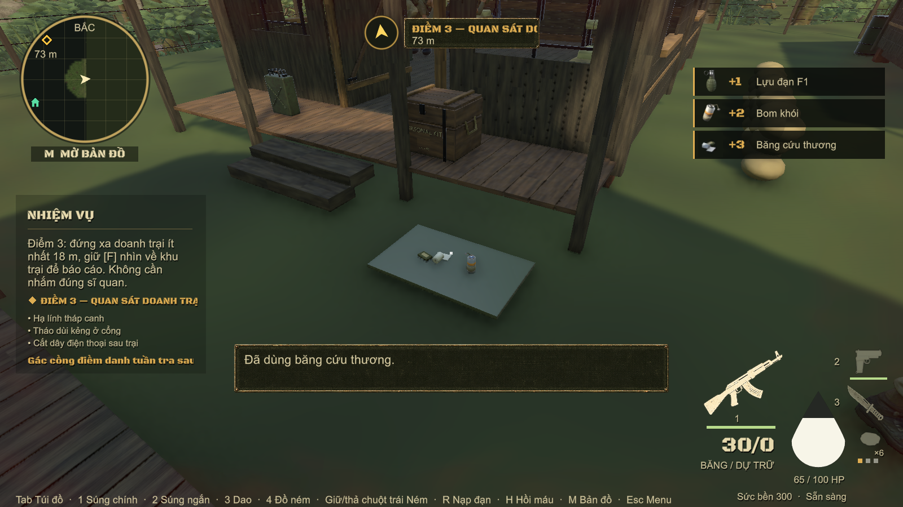

# Tiếp tế theo tiến trình và nhịp bắn địch — 22/10/2026

Đã triển khai vào game theo phản hồi: Nam tới C3 có nhiều linh kiện nhưng thiếu đồ ném và băng; nhiều địch M16 bắn liên tục khiến mất máu quá nhanh. Đây là đợt sửa tiếp theo sau bản cân bằng M16 của Nam và phương án C3 ban đầu.

## Nguyên nhân và cách sửa

M16 của địch đang dùng khoảng cách từng viên 0,1 s thay cho cả `guardShotInterval` 1,6 s khi `_burstRounds == 1`. Vì thế lính thường bắn liên tục; số M16 nhiều khiến DPS cả nhóm tăng rất cao. Cách xử lý mới áp tốc độ 600 RPM bên trong loạt, rồi có nhịp nghỉ rõ ràng. Không tiếp tục giảm thông số M16 của Nam để bù cho lỗi điều khiển cò của NPC.

Khói ở túi lính nhiệm vụ trước đây chỉ có khoảng 8,48% mỗi túi; F1 khoảng 1,38%, chưa tính hỗ trợ hoặc nguồn khác. Tỉ lệ hiếm như vậy không bảo đảm người chơi biết và dùng được hai công cụ trước C3. Linh kiện có nhiều nguồn, còn vật phẩm dùng ngay lại phụ thuộc chế tạo, loot may rủi và hòm sau giao chiến. Bản sửa đưa vật phẩm hoàn chỉnh vào mốc nhiệm vụ và nguồn tiếp tế hữu hạn.

Giao diện kho còn có lỗi cắt danh sách ở 8 dòng, trong khi stock cũ có 9 món và khói nằm cuối nên không hiện. Đã thay bằng vùng cuộn hiển thị toàn bộ 10 món hiện tại, có chỉ dẫn cuộn. Ảnh `store-top.png` xác nhận F1 30 điểm hiện ở đầu; `store-bottom.png` xác nhận khói 15 điểm hiện ở cuối cùng với nút LĨNH.

## Nhịp bắn M16 của lính thường

| Thuộc tính | Mới |
|---|---:|
| Số viên mỗi loạt | 3 |
| Khoảng cách từng viên trong loạt | 0,1 s |
| Nghỉ sau loạt | 1,8 s + lệch cố định 0–0,35 s theo lính |
| Số viên trước nghỉ nạp | 30 |
| Nghỉ nạp | 3,2 s |
| Loạt M16 thường bắn đồng thời | Tối đa 2 |

Các lính còn lại đợi lượt bắt đầu loạt, vẫn có thể di chuyển, tìm chỗ bắn, phát hiện hoặc truy tìm theo AI hiện có. Đạn bắn vào nơi Nam đã biến mất và bắn mục tiêu thay thế cũng dùng cùng bộ đếm/nhịp nghỉ. Khung hình chậm không được bù nhiều phát trong một frame. Burst và số viên đã bắn được lưu cùng snapshot; nghỉ nạp giữ trong `shotRemaining`. Load dữ liệu cũ bắt đầu với bộ đếm hợp lệ bằng 0. Pause cinematic tiếp tục giữ thời gian nghỉ.

Chỉ huy dùng nhịp burst riêng từ profile; M16 không còn ghi đè khoảng cách 0,3 s của profile thành 0,1 s. Không thay logic chọn cover, ném lựu đạn hoặc gọi tiếp viện của chỉ huy.

Với sát thương một viên của lính thường 6,16, mô hình lý tưởng trước sửa là 61,6 HP/s liên tục mỗi M16. Chu kỳ mới 30 viên có nghỉ nạp và độ lệch trung bình khoảng 22,975 s, tương đương khoảng 8,04 HP/s nếu mọi viên đều trúng và chưa tính tranh lượt bắn. Đây là tính toán thiết kế, không phải DPS đo trên người chơi: xác suất trúng, cover, khung hình và di chuyển còn ảnh hưởng kết quả. Nam vẫn có thể chết khi đứng chịu nhiều nguồn sát thương.

## Nguồn tiếp tế đã áp dụng

| Thời điểm / địa điểm | Phần chắc chắn được thêm hoặc điều chỉnh |
|---|---|
| Thùng ban đầu căn cứ A | Giữ 2 băng + 60 AR và nguyên liệu cũ; thêm 1 bom khói. |
| Bàn giao hàng C1 cho chỉ huy, trước nhận nhiệm vụ điểm 2 | Giữ 2 băng + 30 AR + vật phẩm tiếp tế cũ; thêm **1 khói + 1 F1**. Không phụ thuộc hạ hết lính hay mở hòm phụ. |
| Hòm trại C1 | **2 băng + 1 khói + 1 F1**, cùng đạn K54/dầu/thuốc súng cũ và roll riêng. |
| Hòm trại C2 | **3 băng + 2 khói + 1 F1**; giảm linh kiện chắc chắn 2 → 1 và module khói 2 → 1; bỏ module ngòi chắc chắn, cấp F1 hoàn chỉnh. Đạn AR 60 và thuốc súng giữ nguyên. |
| Điểm tiếp tế trước C3, gần ổ Mosin ở đồi Đông Nam | **3 băng + 2 khói + 1 F1**. Vị trí đã đo X/Y/Z 109 / 21,42 / 21. Có đường đi từ ổ Mosin. |
| Túi quân y sân Tây C3, trước nhà lính | **2 băng + 1 khói**. X/Y/Z 59 / 8,32 / 56,4. Có đường NavMesh hoàn chỉnh từ cổng; lấy được khi chỉ huy còn sống. |

Hai điểm mới xuất hiện từ nhiệm vụ C3, dùng model vật phẩm hiện có trên tấm vải tiếp tế. Nhặt dùng động tác cúi nhặt; đồ biến mất sau khi lấy. Mỗi điểm có ID lưu riêng, một lần mỗi lượt chơi, không restock. Bản lưu đã nhặt Mosin vẫn còn hai nguồn tiếp tế mới. Hướng dẫn chuyển từ ổ Mosin sang túi tiếp tế trước khi dẫn vào mục tiêu nếu túi chưa lấy.

Phần thưởng bàn giao C1 dùng `Receive`: túi đầy thì vật phẩm nằm dưới chân, tiếp tục thuộc hệ thống đồ rơi/lưu game. Cờ nhận thưởng giữ tính một lần. Không bỏ vật phẩm khi `Add` không còn chỗ như trước. Đồ đã rơi được lưu; điểm tiếp tế đã lấy không đầy lại khi load.

## Loot và kho

- Tier odds chuyển **60/26/11/3 → 52/38/8/2**, tăng bậc thường có đồ tiêu hao và giảm hai bậc vật liệu hiếm.
- Túi lính nhiệm vụ có khoảng **23,73%** ra ít nhất một băng trong 2 roll, trước hỗ trợ thiếu máu; trước là 16,58%. Khi dưới 75% máu và không có băng, trọng số băng ×3. Các xác suất được tính theo bậc và tổng trọng số, không coi tier odds là xác suất trực tiếp của món đồ.
- Khi còn dưới 2 băng, chậm nhất túi thứ 3 tính từ lần gần nhất có băng sẽ được bù 1 băng nếu roll không cho. Không bù thêm khi đã có từ 2 băng. Túi đã roll được giữ nguyên, đổi nhu cầu hoặc tải lại không roll lần nữa.
- Thêm khói hoàn chỉnh ở tier 3 của túi lính nhiệm vụ. Linh kiện súng trung bình từ roll túi loại này giảm **0,088 → 0,032 món/túi**; còn nguồn rã súng và các hòm khác.
- Giá kho: băng **20 → 12**, khói **25 → 15**, F1 **40 → 30** điểm. Kho cấp F1 trực tiếp. 40 điểm hậu cần đầu tiên đủ mua **2 băng + 1 khói = 39 điểm**.

Băng vẫn hồi 45 HP. Không tăng HP tối đa hoặc xóa linh kiện người chơi đang mang. Đạn của các súng và thông số M16 Nam 22 damage / 600 RPM / 80 m giữ theo đợt trước. Mosin giữ một phát hạ địch và 200 m; không tăng tầm nhìn của địch hoặc tự cấp thông tin vị trí Nam.

## Kiểm chứng

Đợt đầu `flow-tests.xml`: **18/18 đạt**, gồm thử nhịp M16 trên nhóm 6 lính, đủ 31 phát qua lần nạp, lưu bộ đếm, profile chỉ huy, tiếp tế/đường đi/nhặt/lưu-tải, băng hồi 20 → 65, pity và các ca loot/base/combat.

**35 test riêng biệt đạt ở kết quả mới nhất, 0 lỗi còn lại.** `test-summary.json` ghi đầy đủ tên và XML bằng chứng. Đợt kiểm tra C3/loot/save `final-tests.xml` đạt 28/29; một test guide còn chờ đường dẫn cũ. Đã sửa test để xác nhận đủ chuỗi Mosin → túi tiếp tế → quan sát → chỉ huy, chạy lại đạt trong `polish-tests.xml` (4/4). Lượt này cũng xác nhận save cũ không lặp phần thưởng, phần thưởng C1 khi túi đầy và giao diện kho cuộn/mua đồ. 9 ca C3 và 2 ca perception/tiếp viện đều đạt.

`guard-fire-evidence.txt` chứa timestamp từng phát thật; `field-supply-evidence.txt` chứa vị trí và kiểm tra save. `supply-reward-evidence.txt` ghi kiểm tra phần thưởng C1 khi túi đầy; `store-evidence.txt` ghi cấp phát khói, F1, 2 băng với 69 điểm. Đã xem trực tiếp hai ảnh kho để kiểm tra dòng cuối không bị cắt. `audit_balance.py` tái tạo phép tính và ghi `balance-audit.json`. Kiểm thử tự động không thay thế buổi chơi thử độ khó với người chơi.

Ảnh lấy từ sandbox bản sao Map 1 chạy code thật. HUD +3 băng/+2 khói/+1 F1 là phần vừa lấy ở điểm trước C3; vật phẩm còn nằm trên tấm vải trong ảnh là túi quân y sân Tây chưa lấy.

## Liên hệ với phương án trước

Đợt này ưu tiên phản hồi thực tế về thiếu đồ và bị xả quá nhanh: áp dụng hai điểm tiếp tế và luồng nhận đồ sớm. Không áp toàn bộ 8 điểm, không giảm túi đạn lính xuống trung bình 6, không đổi bố trí địch hoặc các timer kẻng/điện thoại C3. Địa hình và scene nguồn giữ nguyên; dựng điểm mới bằng code. Nguồn tham khảo thiết kế đã đọc ở báo cáo `../M16_C3_Balance_20261022/PHUONG_AN_C3.md`, nhất là nguồn đồ có chủ đích và khoảng nghỉ giao chiến từ Valve/Left 4 Dead; thông số thực tế ở đợt này do dự án tự chọn và kiểm thử.

Chưa commit/push hoặc thay dữ liệu máy chủ.
