# Tutorial Hùng — bản chơi thử

Scene: `Assets/_Project/Scenes/Maps/Map00_Tutorial.unity`.

## Chơi thử

- Từ menu chính chọn **CHƠI MỚI → CHƠI HƯỚNG DẪN**. Chọn **BỎ QUA HƯỚNG DẪN** để bắt đầu Map 1 mới.
- Tuyến nhiệm vụ đi từ ngoài căn cứ gốc tới cầu gỗ/bến B, tiến dần theo một hướng khoảng 145 m. Các bài 0–7 nằm trên cùng một trục đất có sẵn; đoạn cuối theo ramp gỗ lên bến. Giữ nguyên vị trí căn cứ, địa hình, cây/đá và cảnh xung quanh. Rào tutorial giới hạn vùng chơi.
- **Kiện hàng cần quét nằm ngay trên sàn cầu gỗ**. Giữ F, hướng ống nhòm vào kiện hàng để ghi nhận. Trinh sát xong Hùng quay về phía căn cứ, vấp cành khô, bị địch phát hiện và đuổi theo. Hùng trúng tay phải, ôm tay chạy, va vào lính chặn phía trước rồi ngã ngồi. Góc nhìn chuyển sang mắt Hùng khi bị đánh báng súng; tối đi rồi cắt sang hai lính kéo Hùng về cầu.
- Bảng nhắc có cụm phím riêng (WASD, Shift, Ctrl/C…), nhãn **NHẤN / GIỮ**, biểu tượng chuột tô sáng đúng bên cần dùng, thao tác chính và dòng chú thích riêng. Phím sáng nhịp nhẹ khi chờ thao tác. Thế giới chậm lại khoảng 0,2× lúc giới thiệu thao tác; thực hiện đúng thì trở lại tốc độ thường để thực hành. UI vẫn chuyển động theo thời gian thực.
- Giao diện theo ảnh mẫu: khung bo góc, nền kính làm mờ cảnh bên dưới, phím rỗng viền vàng phát sáng, chữ trắng và tiêu đề vàng. Bỏ ô **TIẾP THEO**; hoàn thành thao tác thì báo **HOÀN THÀNH** và tự chuyển bài. Thanh tiến độ mảnh chỉ hiện khi đang thực hành/quét dở. Nút thử lại nằm góc phải phía trên, cạnh khu vực bỏ qua.
- Trước khi thực hành ám sát, bắn một lính và hạ tổ lính, camera lia tới đúng mục tiêu trong 0,9 giây, giữ 1 giây rồi trở lại góc chơi trong 0,9 giây. Khi giới thiệu, Hùng/AI chờ và bảng thao tác tạm ẩn; camera quay về mới hiện phím hướng dẫn. Pause dừng nhịp lia, thử lại bài sẽ giới thiệu lại mục tiêu.
- Dải dấu **`> > > >`** nằm trên mặt đất/sàn cầu, sáng lần lượt về hướng mục tiêu. Dải dẫn theo NavMesh, cập nhật theo bước hiện tại; các bài di chuyển dẫn tới trạm kế tiếp, bài dao dẫn tới bụi rồi sau lưng lính, lượt về dẫn xuống cầu về phía căn cứ. Chỉ vẽ tối đa 48 m phía trước, ẩn lúc pause, mở bảng/túi đồ, thất bại hoặc cutscene. Các dấu là hình tạm lúc chạy game, không sửa map hay dữ liệu đường đi.
- Mũi tên theo mẫu vàng: hình liền mạch có viền vàng đồng, lõi sáng và quầng sáng mềm; đặt cách nhau 1,8 m, từng mũi bám mặt đất/dốc cầu. Giữ các mũi tên rời nhau, không có đường nối mảnh. Nhịp sáng vẫn chạy về phía mục tiêu bằng thời gian thực.
- Chạy và đi khom là nhấn bật/tắt: **Shift**, **Ctrl/C**. Vũ khí: **1 súng, 2 dao, 3 tay không**. Giữ/thả **Q** ném đá; chuột phải ngắm, chuột trái bắn/hạ dao, **R** nạp đạn, **H** dùng băng, giữ **F** trinh sát.
- Fail ở bước nào thì chọn **Thử lại bước này** hoặc Enter trên màn thất bại. Có thể thử lại chủ động qua Esc/menu; các bước trước được giữ hoàn thành. Checkpoint ở trong bộ nhớ, thoát tutorial sẽ mất tiến trình.
- **Bỏ qua toàn bộ hướng dẫn** có trong menu tạm dừng và màn thất bại; dẫn tới Map 1 mới. Khi xem cảnh kết, giữ Esc 1 giây để vào Map 1, hoặc nhấn/thả Esc để mở menu.

## Xem riêng cutscene

- Trong Unity chọn **ShadowVale → Tutorial → Xem thử cutscene bắt Hùng**. Lệnh mở tutorial rồi bắt đầu ngay đoạn kết, không phải chơi lại các bài.
- Chuỗi khoảng 25 giây: cận chân vấp cành → cận địch phát hiện → camera vòng cảnh đuổi → chéo trước (Hùng gần bên phải, lính xa bên trái) → cận lính bắn → máu ở tay phải → cận ôm tay chạy → va ngực lính → ngã ngồi → mắt Hùng thấy lính nâng súng chếch lên một bên rồi dộng báng xuống → camera giật, đầu gục sang bên và tầm nhìn mờ dần → tối hẳn, giữ màn đen 1,1 giây → hiện hai lính kéo về cầu.
- Cú vấp dài 2,05 giây: mũi dép mắc vào đầu cành cây thật trên sàn, chân bị giữ trong lúc thân chúi về trước; chân còn lại bước qua để đỡ trọng lượng, rồi chân bị vướng nhấc lên thoát cành. Tiếng “rắc” phát ở nhịp tiếp xúc. Ảnh động: `Previews/TutorialCapture/15-stumble-foot-contact.gif`.
- Góc nhìn Hùng dài 3,35 giây, thấy toàn khẩu súng khi lính nâng chếch lấy đà; hai tay ở trước ngực, cú dộng tăng tốc trong 0,3 giây cuối và chạm khoảng giây 1,85. Camera giật ngắn rồi hạ/nghiêng/xoay theo đầu gục sang bên, mất nét tăng dần trước khi fade. Đen hoàn toàn rồi mới đổi vị trí người/camera cho cảnh kéo đi. Ảnh động: `Previews/TutorialCapture/17-grounded-strike-and-drag.gif`.
- Bàn chân được căn theo hình đế dép Hùng và lấy cao độ ở gót/mũi/hai mép dép. Sau pose ngã ngồi hoặc kéo, cổ chân trở về tư thế thả lỏng, mũi hơi ngửa và gót bám độ dốc; phần chân được giải lại để dép không lún xuống nền.
- Dữ liệu đế dép/trọng số xương được chuẩn bị sẵn trong `Resources/TutorialCapture.asset` bằng `TutorialCaptureSetup.BuildAssets` ở Edit Mode. Cutscene dùng dữ liệu này và transform xương, không đọc `vertices`, `boneWeights` hay `bindposes` của mesh nguồn khi chạy; model Hùng có thể giữ tắt Read/Write. Menu xem thử tự cập nhật dữ liệu trước khi vào Play Mode.
- Mất nét dùng Volume URP riêng trong cảnh kết, có Depth of Field, Motion Blur và Vignette; khôi phục thiết lập camera và huỷ Volume khi hết góc nhìn Hùng hoặc huỷ cutscene. Không sửa Volume hay renderer dùng chung của map.
- Pause dừng cả pose, chuyển động và nhịp camera. Giữ Esc một giây bỏ qua; menu vẫn có bỏ qua toàn bộ hướng dẫn.
- Lính truy đuổi giữ chuyển động liên tục qua các shot: bắt đầu đúng vị trí vào cảnh chạy, dừng tại chỗ để bắn và tăng tốc đuổi lại sau phát bắn. Đoạn phía sau cành cây bám đường đi trên NavMesh có sẵn qua sàn chờ và cầu dẫn, tránh cắt ngang mép sàn rồi rơi xuống nền bên dưới. Không đặt lại toạ độ lính giữa các shot này. Skin tiếp tục cập nhật khi ra ngoài khung và camera phim tạm tắt occlusion culling; trả các cờ này khi huỷ/hết phim.
- Clip được tham chiếu qua `Resources/TutorialCapture.asset`. Hùng dùng clip chạy tay trống; lính kéo dùng clip đi tay trống. Pose ôm tay, ngã ngồi, đánh báng súng và nắm tay kéo được ghép bằng IK có giới hạn gập khớp; không ép góc cổ tay của rig khác. Đây chưa phải motion capture riêng.

## Dựng lại

- Menu **ShadowVale → Tutorial → Tạo (hoặc làm lại) từ Map 1**. Tool lấy bản copy riêng, giữ cảnh hiện có, gắn Hùng/UI/lính, bake NavMesh/tactical graph và thêm Build Settings.
- Lưu thay đổi gameplay vào `Assets/_Project/Prefabs/Tutorial/Tutorial Root.prefab`, apply override trước khi dựng lại. Scene được tạo lại; prefab đã lưu được giữ.
- Bố cục mặc định ở `Assets/_Project/Map01/tutorial_layout.json`; máu, đồ đầu màn, tốc độ gợi ý và thông số hướng dẫn ở `tutorial_balance.json`.
- Các điểm `Lesson 0..10`, lính, hàng tiếp tế, bẫy và rào nằm trong Tutorial Root. Khi đã có prefab, chỉnh điểm/đồ đặt trong prefab; cấu hình layout điều khiển vùng cảnh/bake. Đổi bố cục mặc định trong JSON không tự ghi đè các chỉnh sửa đã lưu trong prefab.
- Khi chủ động đổi toàn bộ toạ độ: mở Map 1 để lấy cao độ nền, chạy **ShadowVale → Tutorial → Áp dụng toạ độ JSON vào Tutorial Root**, rồi dựng lại tutorial. Lệnh này dời các trạm/lính/mục tiêu theo JSON và tạo lại rào; UI và các phần khác của prefab được giữ.
- Tạo lại model bằng **ShadowVale → Characters → Setup Hung Player**. PlayerHung là variant của Player, dùng avatar Hùng và AC_Player. Model Nam được giữ vô hiệu hoá trong variant; Hùng dùng skeleton riêng và WeaponAnchor ở tay phải. Tay nắm đấm là yêu cầu đã chốt.
- Hùng được đo trong cùng tư thế đứng với Nam, tăng đồng đều tỷ lệ Model và khớp cao độ đế chân. Capsule cao 1,8 m như Nam. Menu **ShadowVale → Characters → Match Hung Player Size To Nam** cân lại prefab hiện có. `HungPlayerGrip` chỉnh rifle về lòng bàn tay Hùng và đỡ bằng tay trái, hướng nòng theo góc ngắm, nhường quyền điều khiển khi reload/tương tác/cutscene. Nam và FBX nguồn giữ nguyên.
- Bản đầu giữ mesh nền liên tục và các mesh cảnh lớn cần cho góc nhìn. Việc giảm số object không đồng nghĩa cắt nhỏ các mesh đó. Map 1 và asset gốc được giữ nguyên.
- Tool chỉ đặt các object tutorial và bake dữ liệu di chuyển riêng. Không tự dời căn cứ, san/cắt nền, tạo đường đất hoặc xoá cây/đá. Tối ưu và thu gọn cảnh là công việc riêng, chưa thực hiện trong lần sửa tuyến này.

## Kiểm tra

- Kết quả và các ca Map 1 chưa qua: [Tutorial_Validation.md](Tutorial_Validation.md).
- Chạy `ShadowVale.Map01.Editor.TutorialValidation.RunTutorial` trong Editor để lưu NUnit XML vào `Temp/tutorial-tests.xml`.
- `TutorialValidation.RunMap01` chạy bộ Map01, loại category Replay, lưu `Temp/map01-regression.xml`.
- `TutorialValidation.RunRegressionRecheck` chạy lại nhóm menu và các ca tương thích cần chú ý, lưu `Temp/map01-recheck.xml`.
- Cần chơi thử bổ sung tuyến đi, các lối vượt rào và góc ống nhòm. Cảnh kết đã có chuỗi góc máy và pose ghép; motion capture riêng, biểu cảm khuôn mặt và thoại thu âm vẫn là phần hoàn thiện diễn xuất.

## Ảnh cutscene từ lượt chạy trong Unity

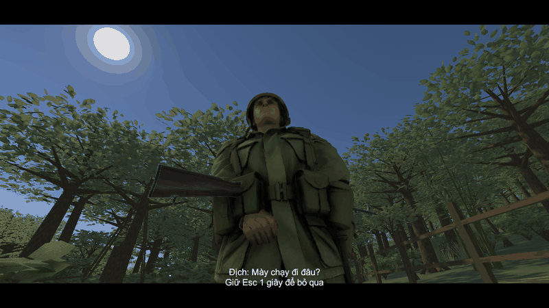

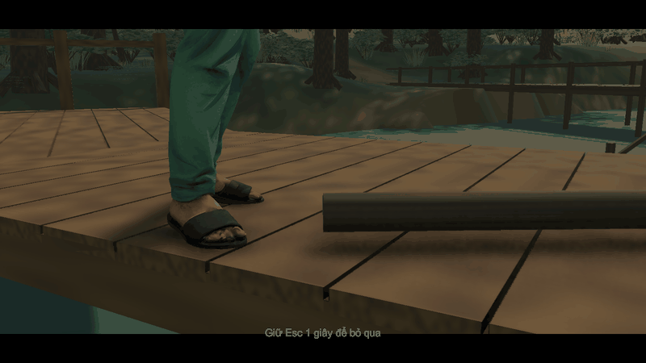

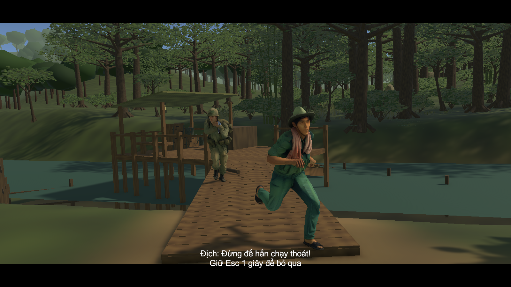

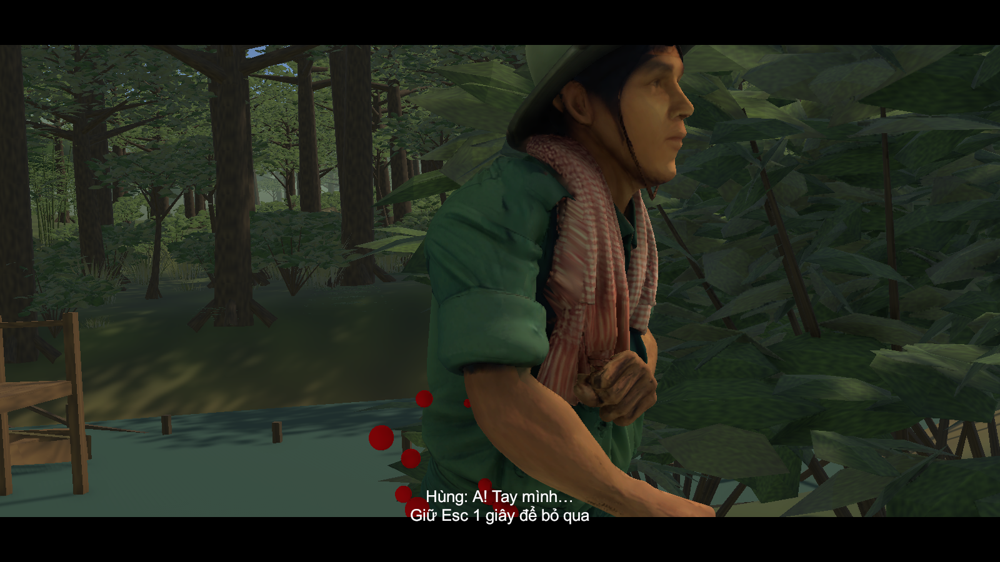

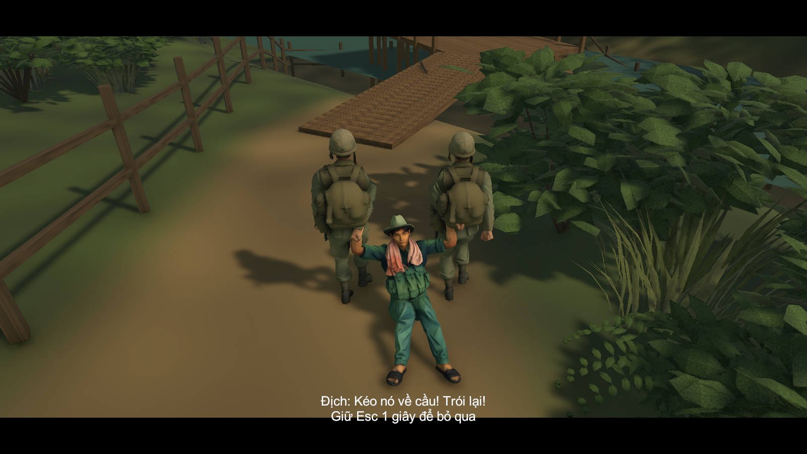

## Hình bản thử

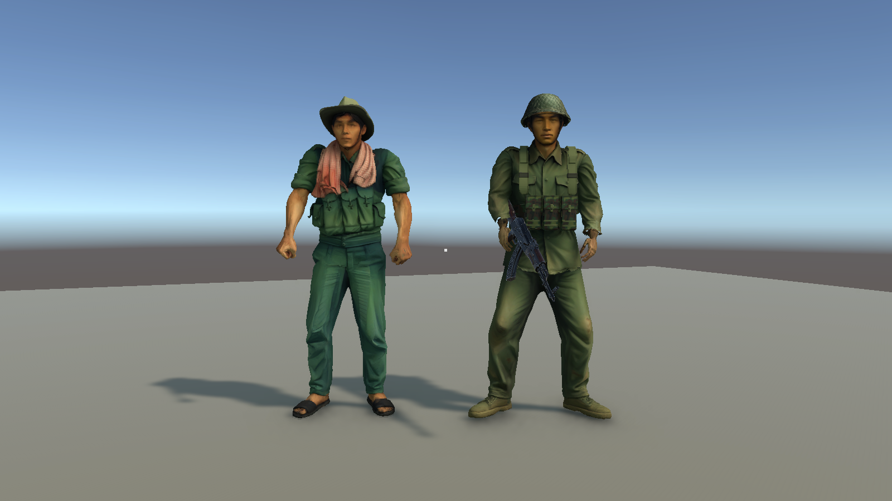

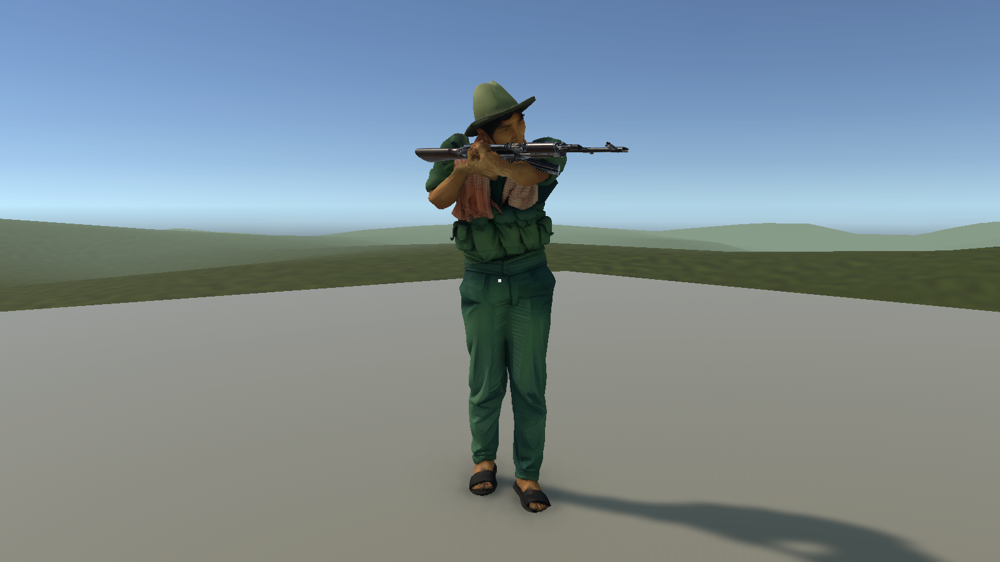

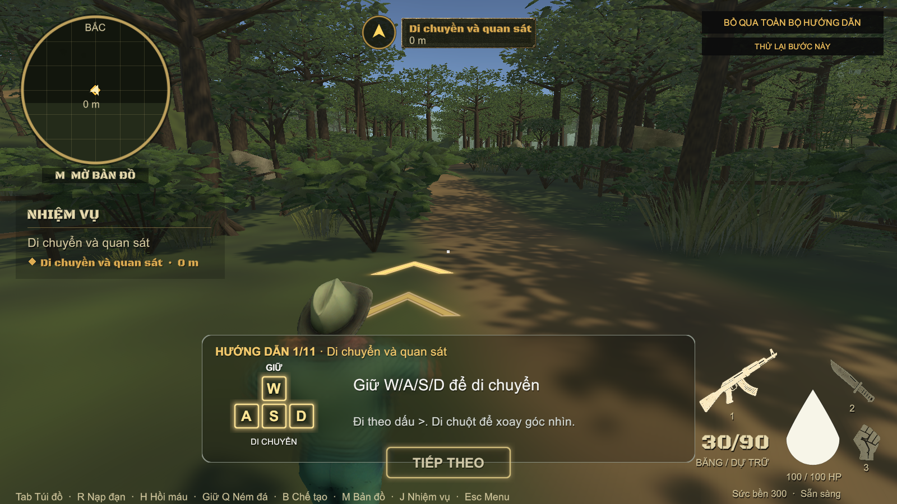

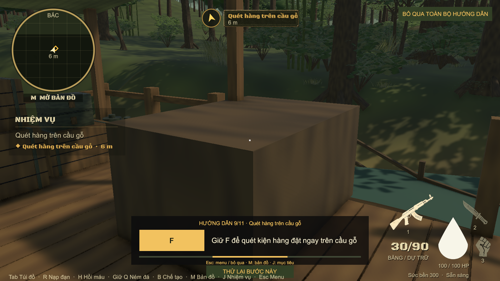

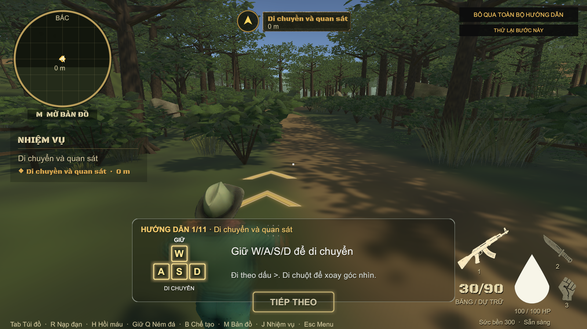

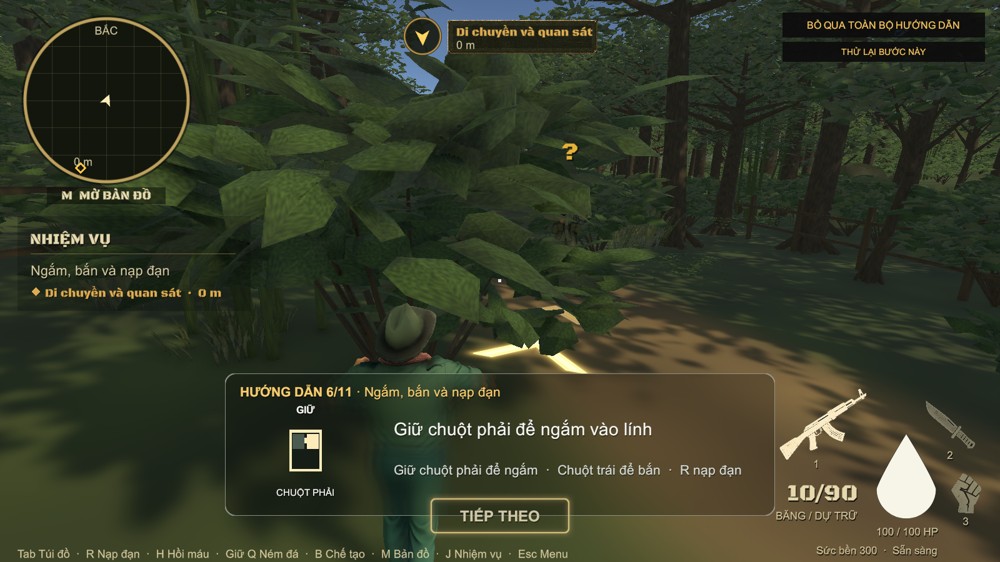

